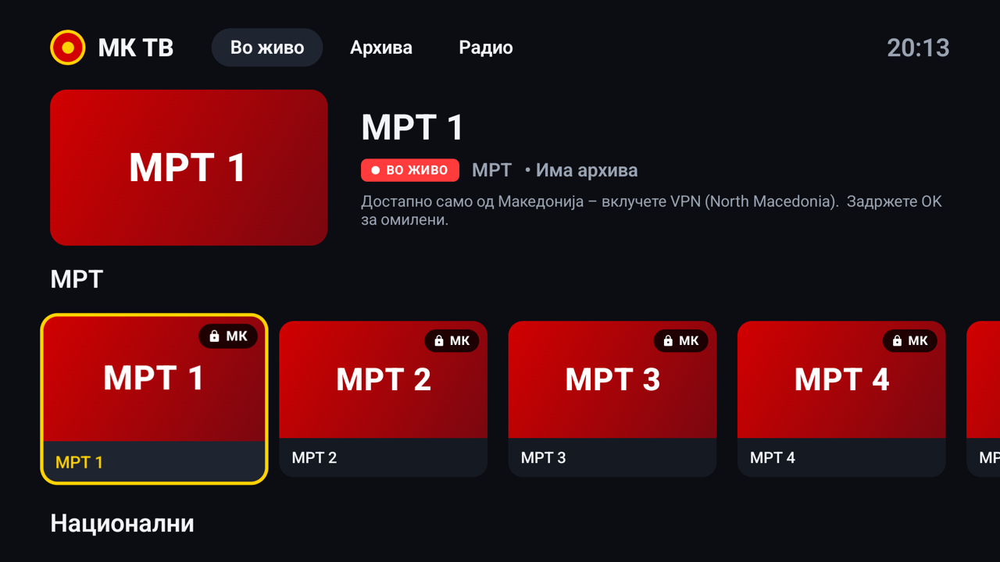
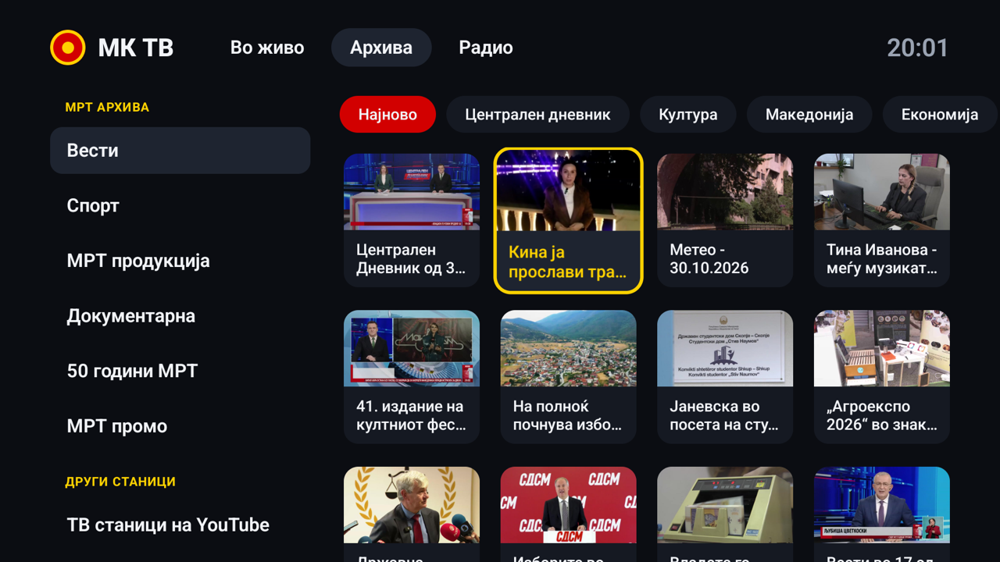
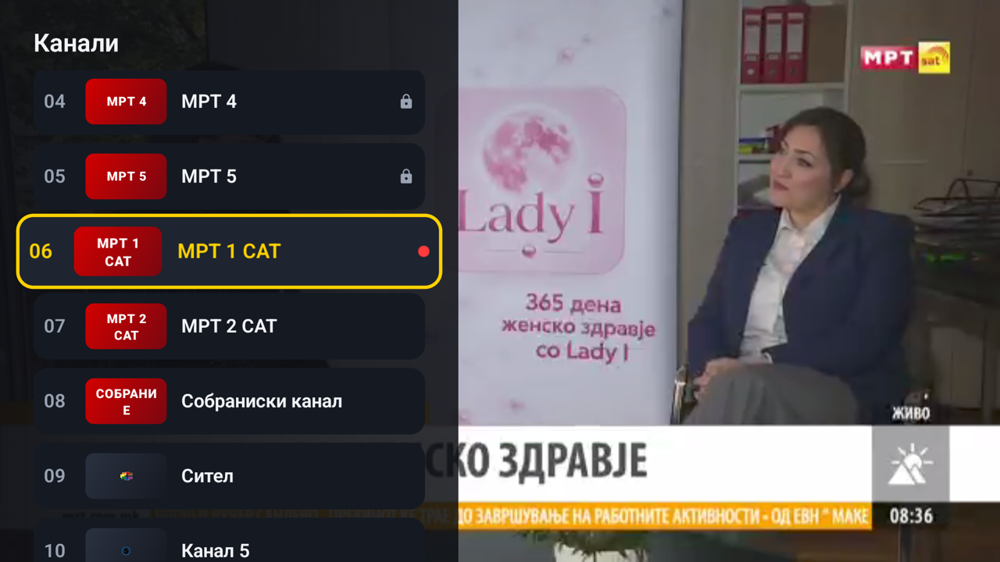
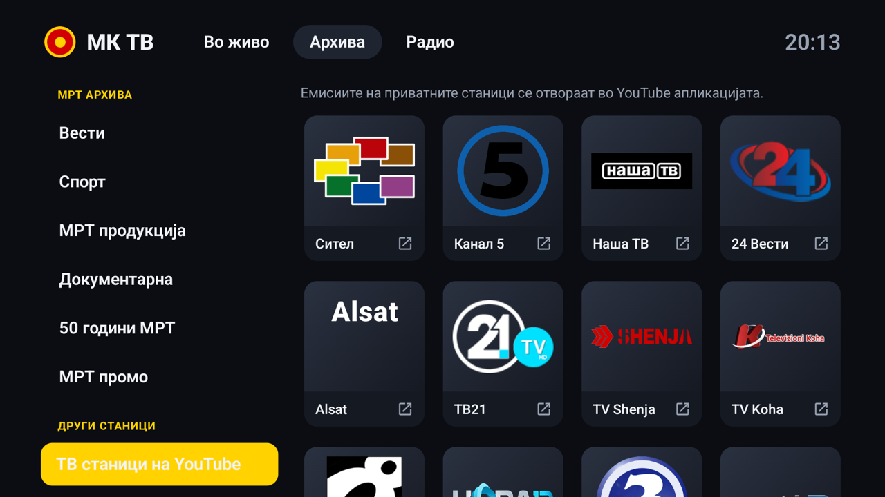
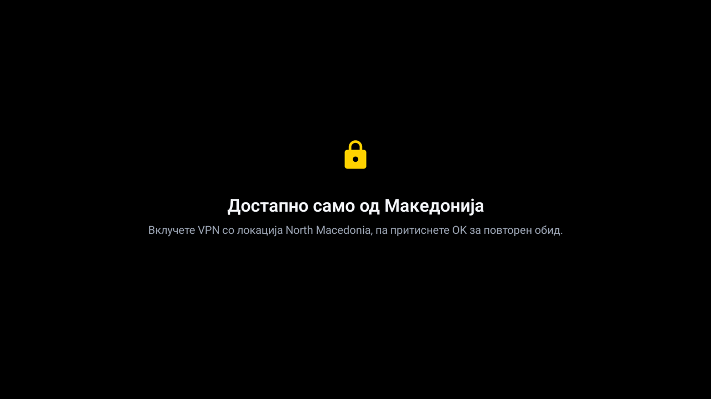

# МК ТВ — Macedonian TV for Android TV

A remote-friendly Android TV app for watching Macedonian television: every **MRT Play** channel, the main private stations, MRT radio, and **catch-up** (past programmes).



## Features

- **Live TV**: 32 channels in rows (МРТ, National, News, Albanian-language, Regional, Music…). A hero panel shows the focused channel.
- **Catch-up**:
  - **MRT archive in the app**: browse sections (News, Sport, MRT Production, Documentary, 50 Years of MRT, Promo), then shows, then episodes, with infinite scroll. The archive plays worldwide.
  - **Private stations**: their official YouTube channels, opened in the YouTube app.
- **Radio**: MR 1, MR 2, MR 3, MR SAT.
- **Built for the remote**: D-pad everywhere, a gold focus ring with zoom, a 10-foot layout with overscan-safe margins, and Macedonian labels.
- **Player**: ▲/▼ or CH+/CH− zap channels, ◀ opens the channel list, OK shows channel info. In catch-up, OK is play/pause and ◀/▶ seek 10 s.
- **Favourites**: hold OK on any channel. The app also remembers the last channel you watched.
- **VPN-aware**: channels limited to North Macedonia carry a 🔒 МК badge. When one is blocked, the app says "turn on a VPN set to North Macedonia" instead of showing an error.
- **Channel list updates over the air**: the app downloads [`channels.json`](app/src/main/assets/channels.json) from this repo, so new or fixed stream links arrive without reinstalling.

| Catch-up (MRT archive) | Channel list in the player |
|---|---|
|  |  |
| **Private stations on YouTube** | **MK-only channel without a VPN** |
|  |  |

## Install on your TV

1. Download `mk-tv-<version>.apk` from [Releases](https://github.com/rmilev/mk-tv/releases).
2. On the TV, install it either way:
   - **Downloader app** (from the Play Store): enter the APK link, then allow "Install unknown apps" for Downloader when asked.
   - **adb**: turn on developer mode and network debugging, then run `adb connect <tv-ip>` and `adb install mk-tv-<version>.apk`.
3. МК ТВ appears in the TV's app row.

**VPN:** MRT 1–5, Alsat, 24 Vesti, MTM, Era, Šutel and M-Net only play from Macedonian IP addresses. Run a VPN app on the TV, set to **North Macedonia**, for those channels. Everything else plays worldwide.

## Channels

| Channel | Group | Live | Catch-up |
|---|---|---|---|
| МРТ 1 · 2 · 3 · 4 · 5 | МРТ | MK only (VPN) | MRT archive (in app) |
| МРТ 1 САТ, МРТ 2 САТ, Собраниски канал | МРТ | Worldwide | MRT archive (in app) |
| Сител, Канал 5, Наша ТВ | National | Worldwide | YouTube |
| Телма, Алфа, Клан Македонија | National | — (no public stream) | YouTube |
| 24 Вести | News | MK only (VPN) | YouTube |
| ТВ21, TV Shenja, TV Koha | Albanian-language | Worldwide | YouTube |
| Alsat, TV Era | Albanian-language | MK only (VPN) | YouTube (Alsat) |
| Канал 8, ТВ Нова 12, ТВ Здравкин | Regional | Worldwide | YouTube |
| МТМ, Шутел, М-Нет HD | Regional | MK only (VPN) | YouTube (M-Net) |
| Folk TV, Love TV, Sky Folk, TopEstrada, Фолк Клуб | Music | Worldwide | YouTube (some) |
| Cool TV, ИНТВ Австралија | Other | Worldwide | YouTube (INTV) |
| М-Нет Kids, М-Нет Sport | Other | MK only (VPN) | — |
| Македонско радио 1 · 2 · 3 · САТ | Radio | Worldwide | — |

Every "Worldwide" stream was checked on 30 Oct 2026 by downloading a real video segment. "MK only" streams answered with a block or no connection from outside Macedonia. Sitel and Kanal 5 come from teve.mk, a public restream listed by iptv-org, because neither station publishes its own live player.

## How it works

- **MRT Play** signs live links for 30 minutes. The app scrapes a fresh link from the channel page each time you tune in, and fetches another one if a link expires mid-stream.
- **The MRT archive** is read live from play.mrt.com.mk: section pages, a JSON episode list paged 24 at a time, then the episode's HLS link.
- **Other stations** are fixed HLS URLs, or page plus regex entries (`type: "page"`) when the link changes.

### Add or fix a channel

Edit [`app/src/main/assets/channels.json`](app/src/main/assets/channels.json) and **increase `version`**. Installed apps pick up the change the next time they start.

```json
{ "id": "example", "name": "Пример ТВ", "group": "Регионални", "logo": "https://…/logo.png",
  "type": "url", "url": "https://…/playlist.m3u8", "mkOnly": false,
  "catchup": { "type": "youtube", "youtubeChannelId": "UC…" } }
```

For a link that changes, use `"type": "page"` with a `"page"` URL and a `"pattern"` regex that matches the `.m3u8` link.

## Build

You need JDK 17 and the Android SDK (platform 35).

```bash
./gradlew assembleDebug          # app/build/outputs/apk/debug/app-debug.apk
./gradlew assembleRelease        # signed if keystore.properties exists, otherwise debug-signed
```

Release signing reads `keystore.properties` from the project root, which git ignores:

```
storeFile=/path/to/release.jks
storePassword=…
keyAlias=mktv
keyPassword=…
```

Stack: Kotlin, Jetpack Compose for TV (`androidx.tv:tv-material`), Media3 ExoPlayer (HLS), OkHttp, Coil, kotlinx.serialization.

## Disclaimer

This is an unofficial, non-commercial app. All programmes, logos and trademarks belong to their broadcasters: Македонска радио телевизија and the stations listed. The app only plays streams that the broadcasters (or public directories such as iptv-org) make available on the web, and it does not bypass geo-restrictions or DRM.
